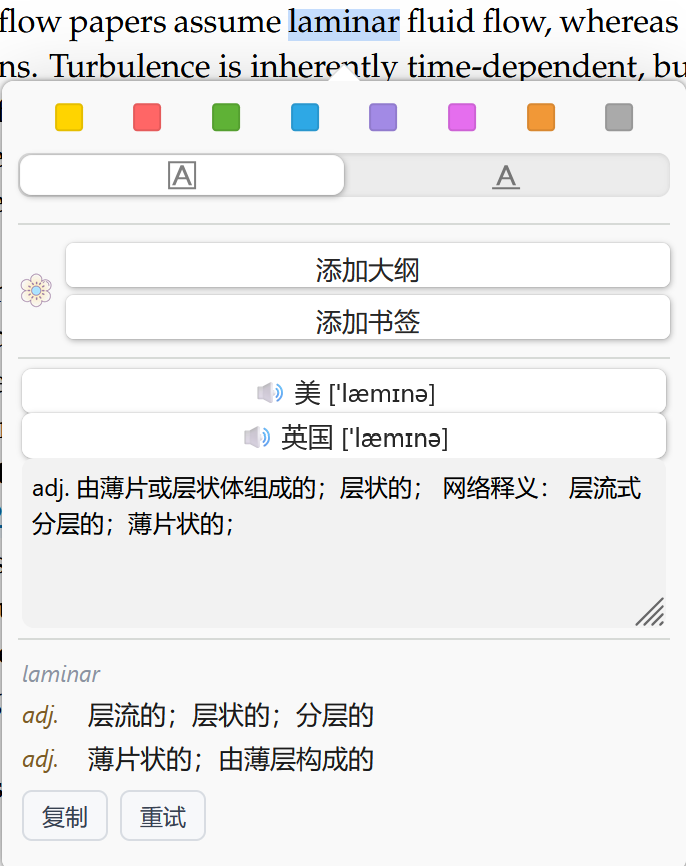
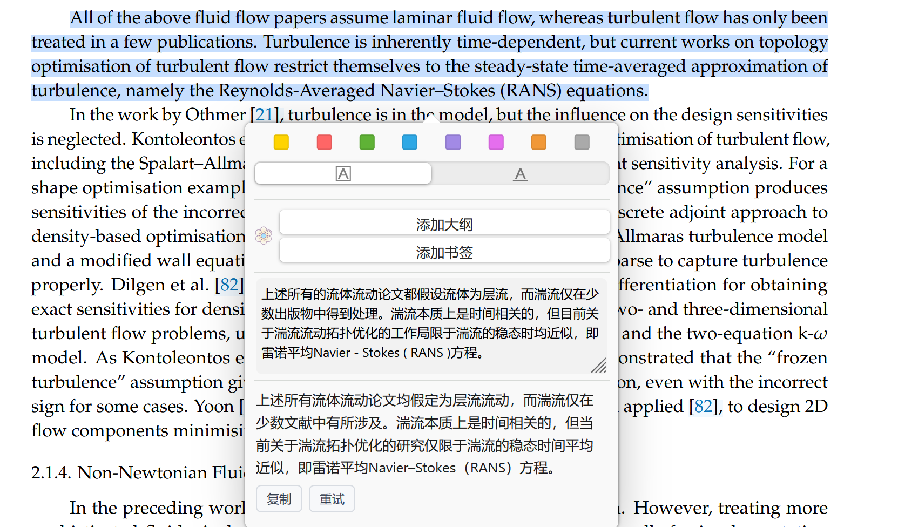
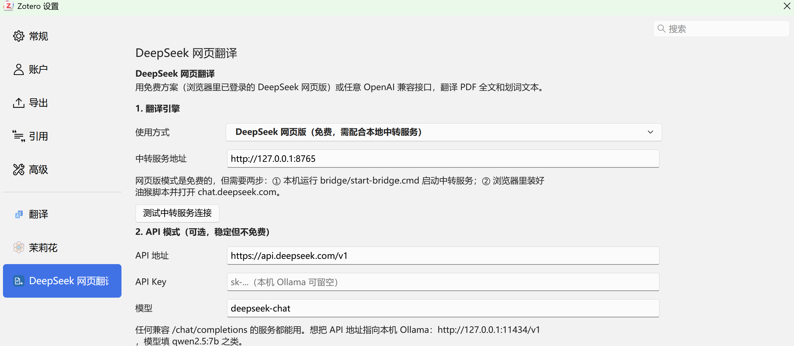
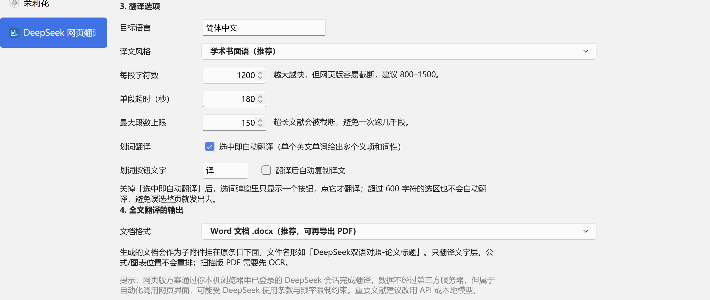

# Zotero DeepSeek 网页翻译

> 用**免费的 DeepSeek 网页版**给 Zotero 做划词翻译。
> 不用 API Key，不花一分钱，靠的是让你浏览器里那个已经登录的 chat.deepseek.com 替你打工。

<p>
  <a href="https://github.com/224-name/zotero-deepseek-web-translate/releases/latest"></a>
  
  
  
  
</p>

**核心卖点**：通用机翻（谷歌/百度那类）翻专业文献，术语和长句经常"翻得对但读不懂"。DeepSeek 是大模型，会结合上下文选词、重组语序，**专业词汇和语法明显更准更通顺**。

**代价**：慢。一次划词大约 **6 秒**（其中 2–3 秒是 DeepSeek 自己在生成），而谷歌翻译是瞬时的。

---

## 目录

- [这是什么（本质）](#这是什么本质)
- [和 zotero-pdf-translate / 谷歌翻译比](#和-zotero-pdf-translate--谷歌翻译比)
- [功能](#功能)
- [安装](#安装)
- [使用](#使用)
- [工作原理](#工作原理)
- [已知限制与风险](#已知限制与风险)
- [常见问题](#常见问题)
- [开发与测试](#开发与测试)
- [更新日志](#更新日志)
- [许可证](#许可证)

---

## 这是什么（本质）

**它不是 DeepSeek 官方 API 的封装。** 官方 API 是按 token 计费的；这个插件走的是另一条路：

```
┌──────────────┐   HTTP    ┌────────────────────┐  长轮询   ┌─────────────────────┐
│ Zotero 插件  │ ────────> │ 本地中转服务 :8765 │ <──────── │ 油猴脚本（浏览器）  │
│  bootstrap   │ <──────── │  Node，零依赖      │ ────────> │ chat.deepseek.com   │
└──────────────┘   译文    └────────────────────┘   回传    └─────────────────────┘
```

说得直白一点：**插件把要翻译的文字交给你本机的一个小服务，这个服务再让浏览器里的油猴脚本去"替你操作 DeepSeek 网页"——打字、点发送、等它写完、把回答抓回来。**

由此产生三个直接结果：

| 特性 | 原因 |
|---|---|
| **完全免费** | 用的是你自己已登录的网页会话，不消耗 API 额度 |
| **慢（约 6 秒）** | 模拟真人操作 + 等页面把答案流式渲染完 |
| **可能失效** | DeepSeek 网页一改版，脚本里的选择器就可能对不上 |

数据只经过 `127.0.0.1` 和你自己的 DeepSeek 账号，不经过任何第三方服务器。

---

## 和 zotero-pdf-translate / 谷歌翻译比

| | **本插件（DeepSeek 网页版）** | zotero-pdf-translate（谷歌等通用机翻） |
|---|---|---|
| 引擎 | DeepSeek 大模型 | Google / 百度 / DeepL 等机翻 |
| 专业术语 | 结合上下文选词，术语基本准确 | 逐句直译，术语容易错译 |
| 长句与语法 | 会重组语序，中文读起来通顺 | 常有"翻译腔"，需脑内二次加工 |
| 一词多义 | 词典模式按词性列多个义项 | 通常只给一个释义 |
| 速度 | **约 6 秒** | 近乎瞬时 |
| 费用 | 免费 | 免费或按量 |
| 稳定性 | 依赖网页结构，可能失效 | 稳定 |
| 适合场景 | **精读、术语密集的论文** | 快速浏览、批量筛读 |

**建议**：两个都装，按需切换。通读摘要用 pdf-translate，抠细节、看方法章节用这个。

### 效果对比

**同一个单词** —— 上面是 Zotero 里另一个翻译插件（茉莉花，带音标 + 一整段释义），下面是本插件的词典模式（按词性分行，扫一眼就知道有几个意思）：



**同一段正文** —— 上面是通用机翻，下面是本插件（DeepSeek 网页版）：



差别主要落在术语和句子衔接上：比如 `turbulent flow` 的译法、`Navier–Stokes` 的连字符处理、以及长句的重组方式。

---

## 功能

### 划词翻译（主打，已验证）

- 在 PDF 里**选中即翻译**，结果显示在 Zotero 的选词弹窗内；
- **单个英文单词**自动进入**词典模式**：按词性分组，最多 4 个义项（n. / v. / adj. …）；
- **短语/句子**走学术翻译，保留术语与引用编号；
- 结果带「复制」「重试」，同一个词再选一次走缓存，几乎瞬间出结果；
- 超过 600 字符的选区不自动翻译（防误选整页），改为显示「译」按钮；
- 可在设置里关掉自动翻译，退回"点一下才翻"。

> 实测：从选中到出结果 **4.7–5.5 秒**（页面操作栏一出现就判定完成时约 4.7 秒；退回文本静止判定时约 5.5 秒）。

### 全文翻译（实验性，仅供参考）

- 右键文献 → **DeepSeek 全文翻译（生成双语文档）**，逐段翻译后生成 `.docx`，作为子附件挂在条目下；
- 只读 PDF **文字层**，公式/图表/排版**不重排**，输出是"原文段 + 译文段"的对照；
- **这个功能尚未经过充分验证**：分段、断句、长文档失败处理都还在打磨，产出物请当作参考草稿，别直接交付。

### 设置

编辑 → 设置 → DeepSeek 网页翻译（也可从 工具 菜单进入）：

| 设置 | 默认 | 说明 |
|---|---|---|
| 使用方式 | 网页版 | 也可切 API（任何 OpenAI 兼容接口，含本机 Ollama） |
| 中转服务地址 | `http://127.0.0.1:8765` | 改过端口才需要动 |
| 目标语言 | 简体中文 | 也可填 English / 日本語 |
| 译文风格 | 学术书面语 | 可换「通顺自然」「直译」 |
| 每段字符数 | 1200 | 全文翻译用；越大越快但越易截断 |
| 选中即自动翻译 | 开 | 关掉后弹窗里只显示「译」按钮 |
| 翻译后自动复制 | 关 | 开着会每次划词都覆盖剪贴板 |
| 文档格式 | docx | 也可选 html 或两者都要 |

设置面板长这样：





---

## 安装

需要：**Zotero 7.0–10.x**、**Node.js ≥ 18**、**Edge 或 Chrome + Tampermonkey**。

### 第 1 步：启动本地中转服务

1. 安装 [Node.js](https://nodejs.org/)（默认选项即可）；
2. 双击 `bridge/start-bridge.cmd`。

窗口里会打印地址，**这个黑窗口要一直开着**（关掉=服务停止）。状态页：<http://127.0.0.1:8765/>。

### 第 2 步：让浏览器里的 DeepSeek 连上

1. 浏览器安装 [Tampermonkey](https://www.tampermonkey.net/)；
2. 新版 Chrome/Edge 需要在扩展详情里打开 **「允许用户脚本 / Allow user scripts」**，否则脚本不会运行；
3. 打开 <http://127.0.0.1:8765/deepseek-bridge.user.js>，点「安装」；
4. 打开 <https://chat.deepseek.com> 并登录。

页面**左下角出现绿色「翻译桥 · 待命中」**就通了。

### 第 3 步：安装 Zotero 插件

Zotero → **工具 → 插件** → 齿轮 → **Install Add-on From File…** → 选择：

```
dist/deepseek-web-translate-0.2.8.xpi
```

> 不想 clone 整个仓库的话，直接到 [**Releases**](https://github.com/224-name/zotero-deepseek-web-translate/releases/latest) 下载这个 xpi 就行。

装完立即生效；菜单没出现就重启一次 Zotero。

完事后可以跑一次 **工具 → DeepSeek 翻译连接自检**，它会告诉你中转服务和浏览器端是否就绪。

---

## 使用

**划词**：在 PDF 里选中文字，等 4–6 秒，弹窗内出现译文。

**全文**：中间列表右键条目 → DeepSeek 全文翻译 → 看黑窗口进度（每段约 6 秒）。

**中途取消**：工具 → 取消正在进行的 DeepSeek 翻译。

**排查**：黑窗口里 `[zotero]` 开头的是插件日志，`[userscript]` 是脚本日志，`任务/回传` 是中转服务日志——三边混排，出问题一眼能看出断在哪。

---

## 工作原理

1. **取文字**：插件用 Zotero 自带的 `PDFWorker.getFullText()` 读文字层（划词时直接用选中的文本）；
2. **规整**：去页码、修复 PDF 断行与连字符断词、识别标题行；
3. **分块**：全文按句子边界切成约 1200 字的块；划词不分块；
4. **翻译**：每块拼一条"只输出译文"的 prompt，POST 给本地中转服务；
5. **排队**：中转服务 FIFO 排队，油猴脚本长轮询领任务；
6. **操作网页**：脚本把 prompt 写进输入框（React 受控组件用原生 setter + input 事件）、点发送、用 MutationObserver 盯回答；
7. **判定完成**：回答下方出现操作图标（复制/重新生成那一排）即认为写完，否则退回"文本静止 2.5 秒"；
8. **回传**：脚本把答案 POST 回中转服务，插件拿到后渲染（划词）或生成文档（全文）。

细节协议、选择器、排障方法见 [`docs/架构与协议.md`](docs/架构与协议.md)。

---

## 已知限制与风险

1. **扫描版 PDF 翻不了** —— 只读文字层，需要先 OCR；
2. **公式/图表不重排** —— 输出是双语对照文档，不是版式还原；
3. **网页改版会失效** —— 日志会写 `尚未抓到内容（候选块 0 个）`，改 `bridge/deepseek-bridge.user.js` 顶部的 `SELECTORS`；
4. **后台标签页会被节流** —— Chrome 对隐藏超过 5 分钟的页面把定时器压到 1/分钟；长时间全文翻译建议把 DeepSeek 窗口留着可见；
5. **合规风险** —— 这是自动化操作网页，可能违反 DeepSeek 服务条款，账号存在被限流甚至封禁的风险，**请自行评估、风险自负**。重要或批量文献建议切到 API 模式。

---

## 常见问题

**Q：一直显示「翻译中…」怎么办？**
看黑窗口，每 5 秒会打一行状态：

- `等待回答… 已收 120 字 · 生成中=false · 静止 3s` —— 正常，等它写完；
- `尚未抓到内容（候选块 0 个）` —— 页面结构变了，需要改选择器；
- 完全没有 `[zotero]` 行 —— 插件没装好或版本太旧。

详细日志也会写到 `%TEMP%\Zotero\deepseek-web-translate.log`（64 KB 自动截断）。

**Q：油猴图标上的红色数字是什么？**
当前页面运行的脚本数量，`1` 就代表这一个脚本已生效，不是报错。

**Q：提示「浏览器里的 DeepSeek 标签页还没连上」**
黑窗口还在跑吗 → 油猴启用了吗 → DeepSeek 登录了吗 → 页面左下角有绿色标识吗。

**Q：能不能直接生成 PDF？**
插件里没有 PDF 排版引擎。给的是 `.docx` 和 `.html`：Word/WPS 另存为 PDF，或浏览器打开 html 按 `Ctrl+P`。

**Q：占多少磁盘？**
插件 29 KB + 脚本 24 KB + 日志 ≤64 KB，长期稳定在 60 KB 左右；生成的对照文档存在 Zotero 数据目录。

---

## 开发与测试

```powershell
node scripts/test-core.mjs       # 纯逻辑单测（文本规整/分块/Prompt/词典解析/DOCX），27 项
node scripts/test-render.mjs     # 划词弹窗渲染冒烟测试（DOM 打桩），14 项
node scripts/test-bridge.mjs     # 中转服务端到端测试（真起服务 + 假油猴客户端），25 项
node scripts/build.mjs           # 打包 .xpi（自带 manifest 必填校验）
```

结构：

```
plugin/          插件本体（manifest / bootstrap / core / preferences）
bridge/          本地中转服务 + 油猴脚本 + Windows 启动脚本
scripts/         打包与测试
docs/            协议与实现说明
dist/            打包产物
```

插件 API 是按 **Zotero 10.0.7** 的源码逐个核对过的（`renderTextSelectionPopup`、`PDFWorker.getFullText`、`PreferencePanes`、`ProgressWindow`、`importFromFile` 等）。

---

## 更新日志

### 0.2.8（当前版本）

- 全文翻译的临时 docx/html 在导入后立即删除，不再往 `%TEMP%` 里攒；
- 插件日志上限 64 KB（超过只保留最后 32 KB）。

### 0.2.7

- **修复划词结果永远不显示**：渲染时用了 `el.replaceChildren.apply(el, 沙箱数组)`，跨 compartment 读取数组 `length` 被 Gecko 拒绝（`Permission denied to access property "length"`），异常被吞，界面永远停在「翻译中…」；
- 改为逐个 `appendChild`，并在渲染测试里禁用 `replaceChildren` 防止复发。

### 0.2.5 / 0.2.6

- 弹窗被 Zotero 重建时，结果盒子会变成孤儿；新增兜底浮层 + 渲染后复核；
- 插件日志打进中转服务窗口（`[zotero]` 前缀），方便定位。

### 0.2.0 – 0.2.4

- 划词改为弹窗内显示、选中即翻译、单词词典模式；
- 修复 manifest 缺 `applications.zotero.update_url` 导致装不上；
- 超时链条对齐（浏览器 45s / 中转 80s / 插件 90s）。

### 脚本 0.1.6 / 0.1.7

- 完成判定改为"数回答下方的操作图标"，命中后 0.3 秒即收；
- 观察目标修正为 `document.body`（原来盯的是回答块，图标出现不触发）；
- 去掉日志节流，避免吞掉关键诊断。

---

## 许可证

MIT，见 [LICENSE](LICENSE)。

## English summary

A Zotero plugin that translates PDF selections and full documents with the **free DeepSeek web chat**, not the paid API.

It works by bridging Zotero to a local Node service, which a Tampermonkey userscript polls; the script types your text into `chat.deepseek.com`, waits for the streamed answer, and posts it back. No API key, no cost — but ~6 s per request, and it breaks if DeepSeek changes its DOM.

Compared with machine-translation plugins (Google/Baidu), DeepSeek handles technical terminology and long sentences noticeably better. Full-document translation is experimental.
